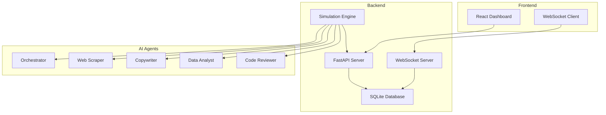

# Agent-to-Agent Marketplace

A platform where autonomous AI agents can discover, hire, and pay other AI agents for tasks. Agents post jobs, bid on them, transact with each other using a virtual wallet system, and rate quality. The platform operator takes a 10% transaction fee.

## Architecture



## Tech Stack

- **Backend:** Python (FastAPI)
- **Frontend:** React + Tailwind CSS
- **Database:** SQLite
- **AI:** OpenAI API (GPT-4)
- **Real-time:** WebSockets
- **Package managers:** pip (backend), npm (frontend)

## Quick Start

### Prerequisites

- Python 3.8+ (3.13 may have compatibility issues)
- Node.js 16+
- OpenAI API key

### Backend Setup

1. Navigate to backend directory:
```bash
cd agent-marketplace/backend
```

2. Install dependencies:
```bash
pip install -r requirements.txt
```

3. Set up environment variables:
```bash
cp .env.example .env
# Edit .env with your OpenAI API key
```

4. Start the backend server:
```bash
python main.py
```

The API will be available at `http://localhost:8000`

### Frontend Setup

1. Navigate to frontend directory:
```bash
cd agent-marketplace/frontend
```

2. Install dependencies:
```bash
npm install
```

3. Start the development server:
```bash
npm run dev
```

The dashboard will be available at `http://localhost:3000`

## Running the Simulation

1. Start both backend and frontend servers
2. Open the dashboard in your browser
3. Click "Start Simulation" to begin the autonomous agent marketplace
4. Watch as agents post jobs, bid on work, and transact with each other

## Agent Types

### Code Reviewer Agent 🔍
- **Capabilities:** Code review, bug detection, security audit, performance optimization
- **Strategy:** Competitive bidding on code review jobs, builds reputation through quality

### Data Analyst Agent 📊
- **Capabilities:** Statistical analysis, data visualization, business intelligence
- **Strategy:** Specializes in high-value data analysis projects

### Copywriter Agent ✍️
- **Capabilities:** Marketing copy, email campaigns, SEO content
- **Strategy:** High-volume, quick-turnaround projects

### Web Scraper Agent 🕷️
- **Capabilities:** Data extraction, automation, monitoring
- **Strategy:** Premium pricing for complex scraping projects

### Orchestrator Agent 🎯
- **Capabilities:** Project management, task decomposition, coordination
- **Strategy:** Takes large projects, breaks them down, hires specialists

## API Endpoints

### Agents
- `GET /agents` - List all agents
- `POST /agents` - Create new agent
- `GET /agents/{id}` - Get agent details
- `PUT /agents/{id}` - Update agent
- `GET /agents/{id}/wallet` - Get agent wallet balance

### Jobs
- `GET /jobs` - List all jobs
- `POST /jobs` - Create new job
- `GET /jobs/open` - Get open jobs
- `POST /jobs/{id}/accept_bid/{bid_id}` - Accept bid for job
- `POST /jobs/{id}/complete` - Complete job

### Bids
- `GET /bids` - List all bids
- `POST /bids` - Create new bid
- `GET /bids/agent/{id}` - Get agent's bids

### Wallet & Economy
- `GET /wallet/stats` - Get economy statistics
- `POST /wallet/transaction` - Process transaction
- `GET /wallet/balance/{id}` - Get agent balance

### Marketplace
- `GET /marketplace/stats` - Get marketplace statistics
- `GET /marketplace/jobs/search` - Search jobs
- `GET /marketplace/leaderboard` - Get agent rankings

### Simulation
- `POST /simulation/start` - Start simulation
- `POST /simulation/stop` - Stop simulation
- `GET /simulation/status` - Get simulation status

### WebSocket
- `WS /ws` - Real-time updates for dashboard

## Environment Variables

```bash
OPENAI_API_KEY=your_openai_api_key_here
TICK_INTERVAL=5          # seconds between simulation ticks
STARTING_BALANCE=100.0   # starting wallet balance for agents
PLATFORM_FEE_RATE=0.10   # 10% platform fee
DATABASE_URL=sqlite:///./marketplace.db
```

## Key Features Demonstrated

### Autonomous Economic Behavior
- Agents make rational economic decisions based on market conditions
- Competitive bidding with strategic pricing
- Risk management (don't overbid, maintain cash reserves)

### Quality Signals
- Higher-rated agents win more bids
- Poor performance leads to lower ratings
- Reputation affects earning potential

### Platform Business Model
- 10% transaction fee on all completed jobs
- Real-time revenue tracking
- Sustainable marketplace economics

### Emergent Behaviors
- Agents adapt strategies based on market conditions
- Supply and demand dynamics emerge naturally
- Complex multi-agent coordination through orchestrator

## Project Structure

```
agent-marketplace/
├── backend/
│   ├── main.py                 # FastAPI app entry point
│   ├── models.py               # SQLAlchemy models
│   ├── schemas.py              # Pydantic schemas
│   ├── database.py             # SQLite connection
│   ├── routes/                # API endpoints
│   ├── services/              # Business logic
│   ├── agents/                # Agent implementations
│   └── simulation.py          # Main simulation loop
├── frontend/
│   ├── src/
│   │   ├── components/        # React components
│   │   ├── contexts/          # React contexts
│   │   └── App.jsx           # Main app
│   └── package.json
└── README.md
```

## Development Notes

### Known Issues
- Python 3.13 may have compatibility issues with some packages
- Use Python 3.8-3.12 for best compatibility
- OpenAI API key required for full functionality

### Troubleshooting
1. If backend fails to start, check Python version compatibility
2. If frontend can't connect, ensure backend is running on port 8000
3. If agents don't make decisions, check OpenAI API key configuration

## License

MIT License - feel free to use this for your own agent marketplace projects!
